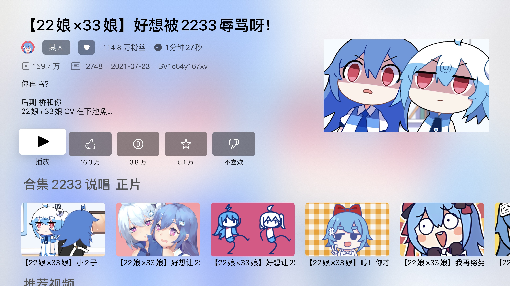
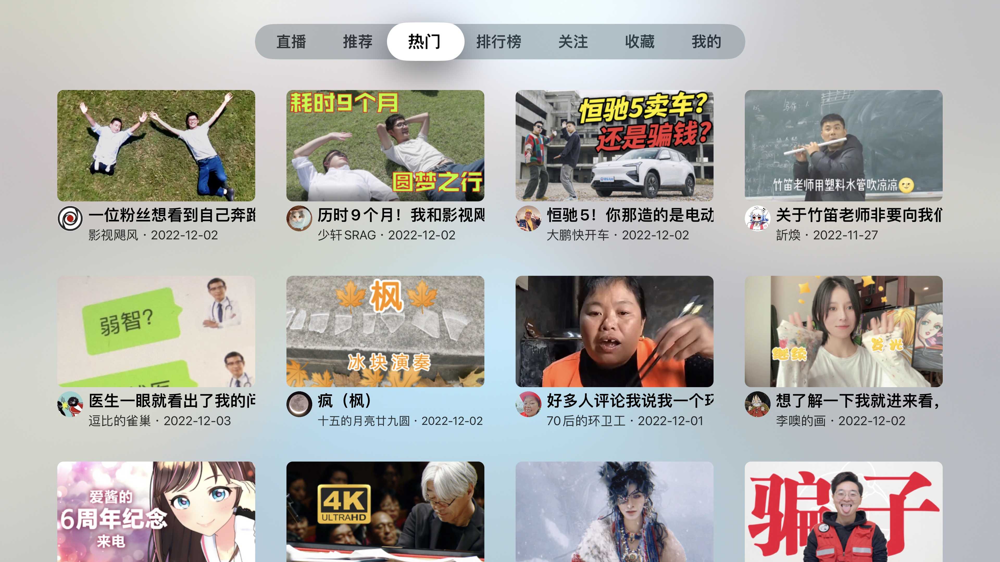
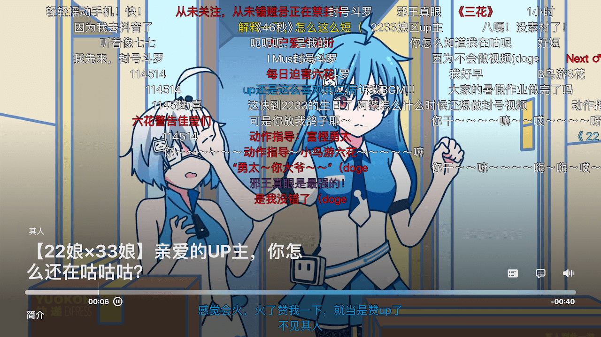

# ATV-Bilibili Family

基于 [yichengchen/ATV-Bilibili-demo](https://github.com/yichengchen/ATV-Bilibili-demo) 的 Apple TV 客户端家庭观看管理改造，沿用上游 GPL-2.0 许可证、播放器和 Bilibili 协议。

## 下载 0.1.1

**[打开 v0.1.1 Release：下载自签安装包、安装说明和对应源码](https://github.com/songdone/ATV-Bilibili-Family/releases/tag/v0.1.1)**

- 安装包：`ATV-Family-0.1.1-build19-unsigned.ipa`
- 平台：Apple TV，tvOS 16.0 及以上，arm64 真机包。
- 这是**未签名 IPA**，必须使用自己的有效 Apple 签名身份及匹配的 tvOS provisioning profile 重签后安装。不是 iPhone/iPad 安装包，也不是 App Store / TestFlight 版本。
- 主应用与内嵌框架的开发签名、描述文件均已移除。不含预设家长 PIN、家庭账本、私人赞赏码或设备标识。
- 默认主应用 Bundle ID：`com.songdone.ATVBilibiliFamily`。重签工具可使用自己获授权的 Bundle ID。

### 自签注意事项

使用明确支持 tvOS 的重签/侧载工具。Development / Ad Hoc profile 必须覆盖目标 Apple TV。工具应先签内嵌框架，再签主应用，并按接收方 profile 设置正确的 `application-identifier` 和 Keychain 访问组；不能复制模拟器权限，不能只签主程序。

首次打开家长控制时设置自己的六位 PIN。若显示“权限数据不可用”，先检查签名和 Keychain 权限，不要禁用安全校验。后续覆盖更新保持 Bundle ID、签名团队和 Keychain 访问组一致；卸载会删除本机登录、孩子和账本数据，部分 Keychain 项可能保留。

## 家庭功能

- 成人模式保留原客户端行为；家长主动开启儿童模式后才应用家庭规则。
- 家庭共享额度、孩子个人额度、连续观看上限与强制休息。
- 工作日/周末观看时段、睡前禁看。
- 家长中心沿用原客户端 UIKit 设置行；设置逐项自动保存，科目只勾选，默认全章节。
- 答题时机与观看奖励；内置四年级通用练习题库 80 题，不是精确教材题库，未经过教师或出版社审定。
- 停播状态页显示休息倒计时、今日可用时间与下次观看时段。
- 家长报告、临时调整、加密本机备份与恢复；重装后可由家长验证并显式创建新账本。

**儿童模式不额外过滤视频列表内容。** 儿童模式下直播、自动视频预览、DLNA/AirPlay/画中画等未接入受控计费的入口受到限制；成人模式保持上游功能。建议家长监督使用。

## 验证范围

同功能版本已在 Apple TV 4K 真机上验证家长 PIN、设置写入及重启持久化、备份恢复与时间确认、重装后的新账本恢复、连续 5 分钟停播/休息提示、答题通过/奖励/自动续播。核心测试 183 项；模拟器 22 项常规回归通过，另用隔离夹具验证 1 项旧账本恢复。

0.1.1 是同功能代码的版本号更新和通用无签名打包，包结构/版本/架构已检查。**接收方使用不同证书重签后的安装与 Keychain 行为、所有 Apple TV 型号、多日运行及外部播放路线并非全部验收。** 不将构建成功视为所有场景已验证，也不提供儿童保护的零风险保证。

## 源码、构建与许可证

- [构建说明](docs/BUILD.md)
- [家庭规则说明](docs/FAMILY.md)
- [隐私说明](docs/PRIVACY.md)
- [题库说明](docs/QUESTION_BANK.md)
- [原 GPL-2.0 许可证](LICENSE.md)

Release 同时提供应用对应源码归档及精确锁定版本的第三方依赖源码归档。源树包含原许可证、上游署名、构建设置和脚本；依赖保持各自上游许可。公开仓库从审查后的文件快照建立，不包含私人开发历史、内部报告或家庭资料。未授权教材 PDF 不随源码分发。

---

# BiliBili tvOS 客户端 Demo（上游说明）

### 本项目没有任何授权的 Testflight 发放以及任何收费版本，请注意辨别和考虑安全性问题。

 **BiliBili tvOS 客户端 Demo 从未在任何平台上架和收费（包括AppStore与Testflight）**

 如果您在任何平台上看到有人以收费方式提供本项目的服务或应用，请注意这是**未经授权的**行为，并且与我们的原始意图不符。我们强烈谴责将本项目用于商业盈利的行为，由此引发的任何安全风险与此项目无关。

### 支持功能
- 二维码登录
- 云视听小电视投屏协议
- 直播与弹幕
- 推荐Feed
- 热门
- 排行榜
- 搜索
- 关注列表
- 历史播放
- 稍后再看
- 系统播放器播放视频
- 视频弹幕
- 热门评论
- 弹幕防挡
- 云视听投屏
- HDR播放
- 字幕

 
 
 

### Telegram Group
 - https://t.me/appletvbilibilidemo

### 未签名iPA文件（原版上游，不是本家庭版）

从 https://github.com/yichengchen/ATV-Bilibili-demo/releases/tag/nightly 获取原版上游构建。

### Links

- App Icon [【22娘×33娘】亲爱的UP主，你怎么还在咕咕咕？](https://www.bilibili.com/video/BV1AB4y1k7em)
- [thmatuza/MPEGDASHAVPlayerDemo](https://github.com/thmatuza/MPEGDASHAVPlayerDemo)
- [dreamCodeMan/B-webmask](https://github.com/dreamCodeMan/B-webmask)
- [分析Bilibili客户端的“哔哩必连”协议](https://xfangfang.github.io/028)
